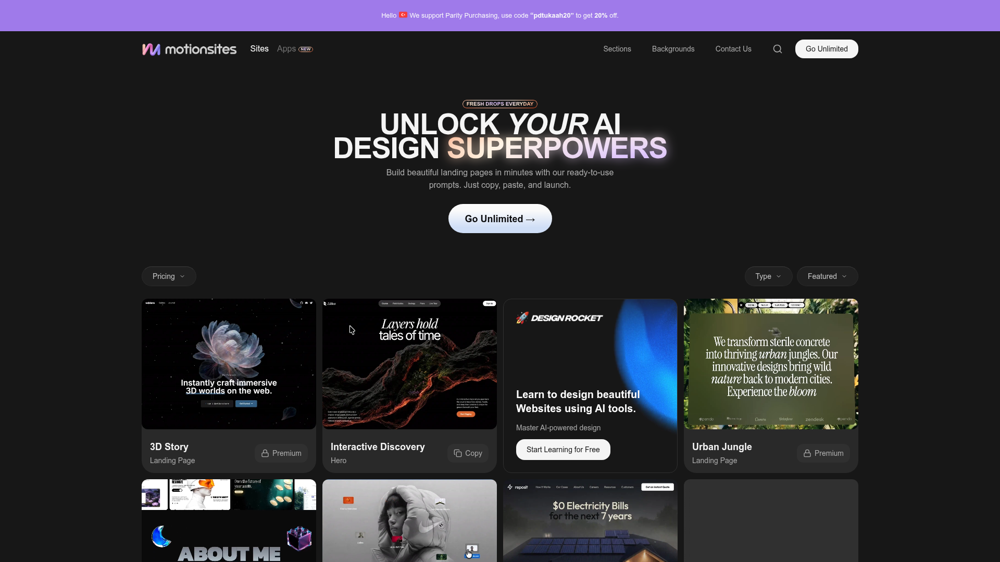

# DESIGN.md: motionsites.ai → CapStack translation

## Source
- URL: https://motionsites.ai
- Capture date: 2026-07-10
- Evidence: Firecrawl branding+images+markdown scrape (`.firecrawl/motionsites-branding.json`), full-page screenshot (`.firecrawl/motionsites-screenshot.png`)

## Reference Screenshot

Use this screenshot as the visual source of truth for layout, hierarchy, density, and feel. Tokens below describe the same page in machine-readable form; the "CapStack mapping" column translates each pattern to CapStack's existing brand system (do NOT copy motionsites' colors/copy verbatim).

## Design Summary
motionsites.ai is a dark, high-energy template gallery. The language: near-black canvas, one massive display headline with a **glowing gradient accent word**, a small glowing pill badge above it, a soft-glow pill CTA, then an edge-to-edge animated card grid. Everything communicates motion — animated webp card previews, hover states, glow shadows. Recreate the *energy and motion patterns*, not the literal brand.

## Design Tokens

### Colors (observed → CapStack mapping)
| Role | motionsites | CapStack equivalent |
|---|---|---|
| Background | `#171717` near-black | `canvas #0B0F17` (keep) |
| Text | `#F5F5F5` | `ink #ECE7DB` (keep) |
| Accent / glow | `#9F7AEA` purple gradient | `brand #C79A3A` → `brand-bright #E0B856` → `gold-soft #FBCE4B` gradient |
| Card bg | `#262626` | `surface #141B27` (keep) |
| Muted | `#9CA3AF` | `ink-muted #93A0B4` (keep) |

### Typography
- Observed: system/Roboto stack, h1 **56px+ (desktop reads ~72-90px)**, heavy weight, tight leading, mixed style (italic serif on one word: "*your*").
- CapStack: IBM Plex Sans, weight 700 (max loaded). Hero at `text-5xl → text-7xl/8xl`, `tracking-tight`, `leading-[1.05]`. Italic accent OK via `italic`.
- Glow accent word: gradient text (`bg-clip-text text-transparent`) + duplicated blurred layer behind for bloom.

### Spacing And Layout
- Base unit 4px; radius 12px (cards), 9999px (pill CTA/badge).
- Hero: centered, ~60vh before content grid. Badge → H1 → subcopy (max ~55ch) → single CTA.
- Section rhythm: generous `py-24`+.

## Components (observed → build)
- **Pill badge**: uppercase, tiny, bordered, outer glow (`box-shadow` in accent). Above H1.
- **Glow CTA**: pill, inner-glow shadow (`inset` white 15%), arrow suffix, hover brightens + scales slightly.
- **Announcement bar**: full-width accent strip on top (CapStack: reuse ComingSoon band instead — don't duplicate).
- **Card grid**: animated preview media, title + category chip + Premium/Copy tag; hover raises card. CapStack: apply hover-glow + lift to curriculum/course cards.
- **Marquee**: "Fresh Drops Everyday" energy → CapStack: infinite topic ticker (DSCR · Cap Rates · LBO · CMBS · IRR ...).

## Motion And Interaction (the point of this whole exercise)
- Hero text: reveal on load (stagger per word), glow pulses subtly.
- Cards: animated previews, hover lift + glow.
- Scroll: sections reveal on enter; smooth, springy easing.
- Cursor-reactive: spotlight/parallax accents (CapStack already has MouseGlow, TiltCard — keep).
- Respect `prefers-reduced-motion` (CapStack global rule already handles).

## Content Style
- Short, punchy, benefit-first. "Unlock your AI design superpowers." → CapStack: "Climb the whole capital stack." (keep, but make it HUGE with glow accent).
- Single primary CTA; secondary link only.

## Agent Build Instructions
1. Keep CapStack palette/fonts — port motionsites' *motion patterns and scale*, not its colors.
2. Hero: kill background video; add layered aurora (blurred brand/info radial gradients, slow drift) + faint grid. Pill badge ("Private beta — onboarding in waves"). H1 with brass gradient-glow on "capital stack." Word-stagger entrance. Magnetic glow pill CTA → scrolls to waitlist.
3. Marquee ticker of course topics after hero.
4. Scroll progress bar (brass, fixed top).
5. Count-up animation on stat strip.
6. `whileInView` reveal on every section.
7. Keep existing: Interactive3DStack, BentoGrid+MouseGlow, ScrollyTelling, FinancialCalculator, TiltCards, Testimonials.

## Rerun Inputs
workflow: firecrawl-website-design-clone
source_url: https://motionsites.ai
target_stack: Next.js 16 + Tailwind + framer-motion + GSAP
output: DESIGN.md
